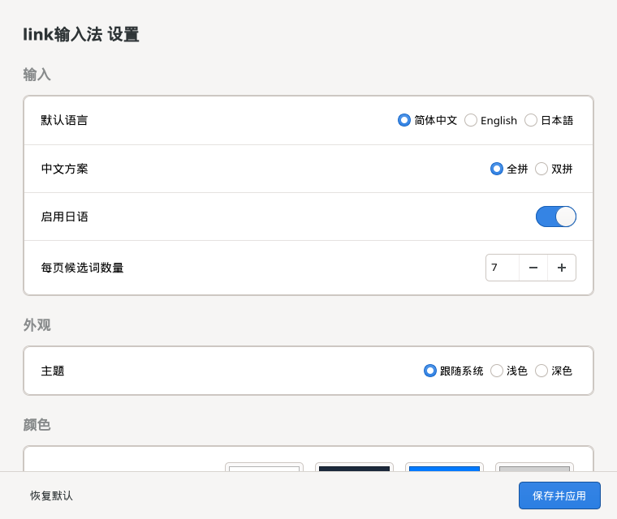

<div align="center">
  
  <h1>link输入法</h1>
  <p><strong>为 niri 做的轻量输入法。</strong><br />全拼、小鹤双拼、英文和日文，共用一套候选栏和设置。</p>
  <p>
    <a href="https://github.com/xieyh2002/link-input/releases/latest"></a>
    <a href="https://github.com/xieyh2002/link-input/releases"></a>
    <a href="https://github.com/xieyh2002/link-input/stargazers"></a>
  </p>
  <p>
    <a href="#安装包"></a>
    <a href="#安装包"></a>
    <a href="#应用兼容"></a>
    <a href="#词库来源"></a>
  </p>
  <p><strong><a href="https://github.com/xieyh2002/link-input/releases/latest">下载最新版</a> · <a href="#候选栏">功能</a> · <a href="docs/installation.md">安装指南</a> · <a href="#输入模式与快捷键">快捷键</a> · <a href="#词库来源">词库</a> · <a href="https://github.com/xieyh2002/link-input/releases">更新日志</a></strong></p>
</div>

## 候选栏

拼音或假名留在应用的光标处，候选词在下方单行排列，长词按实际宽度显示。每页显示 1–9 项；浅色和深色可自动跟随系统，也能固定主题和分别配色。

| 浅色 | 深色 |
| --- | --- |
|  |  |

## 输入模式与快捷键

| 操作 | 功能 |
| --- | --- |
| 单击 `Shift` 或按 `Ctrl+空格` | 按 **中 → 英 → 日** 循环，光标旁短暂显示当前语言。禁用日语后只在中英间切换。 |
| `Ctrl+Alt+1` | 切到简体全拼，提示「全拼」。`nihao` 加空格可输入「你好」。 |
| `Ctrl+Alt+2` | 切到小鹤双拼，提示「双拼」。`nihc` 加空格可输入「你好」。 |
| `Ctrl+Alt+3` | 直达日文罗马字模式。输入 `arigatou` 时会实时出现候选；空格确认当前候选，数字键直接选词，回车确认原假名。 |
| 数字键 `1`–`9` | 选择当前页对应编号的候选。 |
| 长按退格 | 在原生 Wayland 路径连续删除正在组合的拼音或罗马字。 |

从日文切回中文会恢复上次用的全拼或双拼；`Shift` 加其他键仍作为组合键。英文模式直接输入半角标点。中文模式下 `/` 和 `\` 也直接上屏。全拼和双拼均支持常用彩色表情联想：例如全拼 `kaixin` 或小鹤双拼 `kdxb` 可选 😄，文字候选仍保留。

## 词库来源

| 输入模式 | 词库和方案 |
| --- | --- |
| 简体全拼 | [Rime 朙月拼音](https://github.com/rime/rime-luna-pinyin) 的 `luna_pinyin_simp` 方案，使用 `luna_pinyin.dict.yaml`。 |
| 小鹤双拼 | [Rime 双拼](https://github.com/rime/rime-double-pinyin) 的 `double_pinyin_flypy` 方案，与全拼共用朙月拼音词库。 |
| 日文 | [Anthy Unicode](https://github.com/fujiwarat/anthy-unicode) 或 [Debian Anthy](https://salsa.debian.org/debian/anthy) 随系统安装的日文词典，用于假名转汉字。 |

中文由 [librime](https://github.com/rime/librime) 转换，默认从系统的 `/usr/share/rime-data` 读取方案和词库。英文直接输入，无需词库；常用 emoji 联想使用 Link 自带的映射。仓库不附带系统词库。

全拼和小鹤双拼也可以加装 [雾凇拼音词库](https://github.com/iDvel/rime-ice)，并保留朙月拼音作为补充。见[雾凇词库安装说明](docs/installation.md#加装雾凇词库)。

## 设置

安装后在应用菜单打开「link输入法设置」，也可以从终端启动：源码默认安装使用 `link`，Debian 和 Fedora 安装包使用 `link-input`。



- **输入**：默认中文、英文或日文；中文使用全拼或小鹤双拼；可单独关闭日语。
- **外观**：跟随系统、固定浅色或固定深色；浅色和深色各可调整背景、文字、选中项和边框；候选栏字号可设为 10–28 pt，间距可选「紧凑」（默认）或「标准」。
- **候选**：设置每页数量，默认 7 个。点击「保存并应用」重新加载输入法。关闭设置窗口不会退出输入法。
- **拼音**：支持自定义短语；全拼可选自动纠错和模糊音。见[拼音设置](docs/installation.md#拼音设置)。

源码安装的 `link` 收到文件参数时，仍交给系统原有的硬链接命令。

## 安装包

从 [GitHub Releases](https://github.com/xieyh2002/link-input/releases) 下载适合的安装包：

| 系统 | 安装方式 |
| --- | --- |
| Fedora 44（x86_64） | `sudo dnf install ./文件名.rpm` |
| Debian 13（amd64） | `sudo apt install ./文件名.deb` |

安装后按[安装指南](docs/installation.md#登录后启用)配置 niri。其他发行版可以[从源码安装](docs/installation.md#从源码安装)。

## 快速试用

在 niri 会话里，装好[构建依赖](docs/installation.md#依赖)后运行：

```sh
git clone https://github.com/xieyh2002/link-input.git
cd link-input
make all build/demo-entry
bash demo/start.sh
```

试用会打开独立的嵌套 niri 窗口，不改当前桌面配置。关闭试用输入框即可退出。准备长期使用时运行 `make install`，再按[安装指南](docs/installation.md)配置登录启动。

## 应用兼容

| 应用 | 输入路径 |
| --- | --- |
| 原生 Wayland GTK、支持 Wayland 文本输入的应用 | 直接使用 niri 的输入法接口 |
| Qt Wayland、Qt X11、配置为使用 IBus 的 GTK X11 | IBus 模块 |
| 使用 XIM 的旧 X11 / XWayland 应用 | IBus 提供 XIM 传输 |

中文转换使用 Rime，日文转换使用 Anthy Unicode。两条路径的选词和候选栏都由 link 输入法处理，无需 Fcitx5；兼容路径需要 IBus 传输服务。已在隔离环境验证 Wayland GTK、Qt Wayland、Qt X11 和 XIM 的中文上屏。

目前主要面向 niri。应用须接入受支持的输入接口；某些应用需要重开后才能读取环境设置。兼容候选栏位置取决于应用提供的光标坐标，跨屏缩放仍有限制。两条输入路径分别保存 Rime 学习数据。

## 开发

```sh
make all build/qingyin-ibus
./build/qingyin --check-engine
make preview
```

`main.c` 接入原生 Wayland，`ibus.c` 接入 IBus，`panel.c` 负责候选栏，`settings.c` 读取设置；`integration/` 包含 GTK 设置窗口和会话脚本。依赖、安装位置、配置和恢复方法见[安装指南](docs/installation.md)。第三方协议及运行库见[第三方组件说明](THIRD_PARTY.md)。
